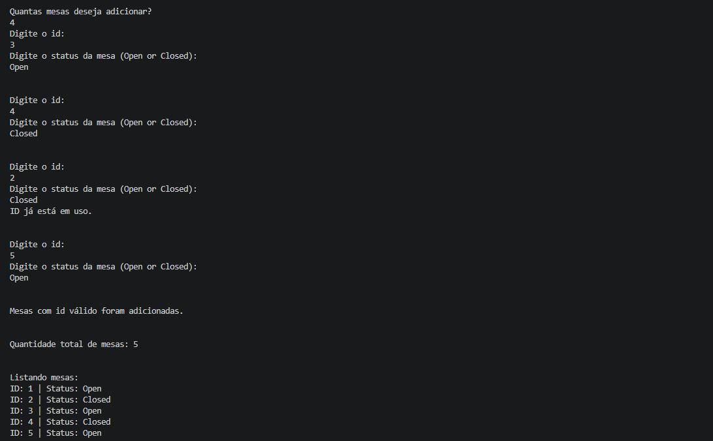
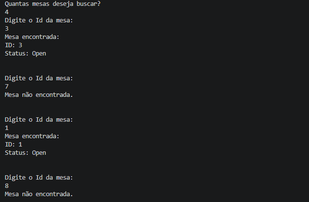
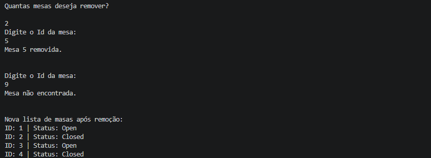

# Atividade — Collections Framework e Exceções

## Objetivo

Desenvolver uma aplicação em Java para gerenciar mesas de um restaurante, utilizando o Collections Framework e mecanismos de tratamento de exceções.

O programa permite cadastrar, listar, buscar e remover mesas, além de tratar situações de erro durante essas operações.

## Tecnologias utilizadas

- Java 8
- Collections Framework (`ArrayList`)
- Tratamento de exceções (`try`, `catch`, `throw` e `throws`)
- Exceção personalizada (`IdException`)

## Estrutura do projeto

```text
AtividadeCollections-Excecoes/
├── src/
│   └── Main.java
└── README.md
```

O projeto foi mantido em um único arquivo Java, `Main.java`, contendo as classes `Mesa`, `IdException` e `Main`.

## Funcionalidades

O programa implementa as seguintes operações:

- **Adicionar mesas:** permite cadastrar novas mesas informando seu identificador e status. Não são permitidos identificadores duplicados.
- **Listar mesas:** apresenta todas as mesas cadastradas, exibindo seus identificadores e respectivos status.
- **Buscar mesas:** localiza uma mesa por meio de seu identificador e apresenta suas informações.
- **Remover mesas:** permite excluir uma mesa cadastrada a partir de seu identificador.

Os status utilizados na aplicação são `Open` e `Closed`.

## Collections Framework

Foi utilizada a estrutura `ArrayList`, pertencente ao Collections Framework do Java.

A escolha dessa coleção se deve à sua capacidade de armazenar objetos dinamicamente, permitindo adicionar e remover elementos durante a execução do programa.

Além disso, sua organização permite percorrer os elementos e realizar buscas por identificador, atendendo às necessidades da aplicação.

## Tratamento de exceções

Foi implementada a exceção personalizada `IdException`, que herda da classe `Exception`.

Ela é utilizada para tratar duas situações:

1. **Identificador duplicado:** ocorre quando se tenta cadastrar uma mesa cujo ID já está presente na coleção.
2. **Mesa inexistente:** ocorre quando se tenta buscar ou remover uma mesa que não está cadastrada.

O lançamento das exceções é realizado por meio de `throw`, enquanto `throws` declara as exceções que podem ser lançadas pelos métodos.

O tratamento é realizado com blocos `try/catch`, permitindo informar o erro ao usuário sem interromper a execução normal do programa.

## Execução

1. Abra a pasta `AtividadeCollections-Excecoes` no Visual Studio Code.
2. Abra o arquivo `src/Main.java`.
3. Execute o método `main()`.
4. Interaja com o programa pelo terminal, informando as quantidades e os identificadores solicitados.

## Testes

Foram realizadas verificações das seguintes operações:

- Cadastro de mesas com identificadores diferentes.
- Tentativa de cadastro com identificador duplicado.
- Listagem das mesas cadastradas.
- Busca por identificadores existentes e inexistentes.
- Remoção de mesas existentes.
- Tentativa de remoção de mesas inexistentes.
- Continuidade da execução após o tratamento de exceções.

## Uso de Inteligência Artificial

Ferramentas de inteligência artificial foram utilizadas como apoio durante o desenvolvimento, principalmente para esclarecimento de conceitos, orientação e revisão pontual do código.

Também houve auxílio na organização e formatação deste arquivo README.

A implementação foi desenvolvida e testada pelo estudante, com acompanhamento e assistência durante o processo.

## Capturas de tela

### Cadastro e listagem


### Busca de mesas


### Remoção de mesas


As excessões fazem com que não se possa cadastrar, buscar ou remover mesas que não condizem com o Id fornecido.