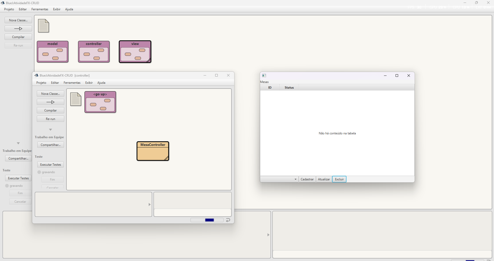
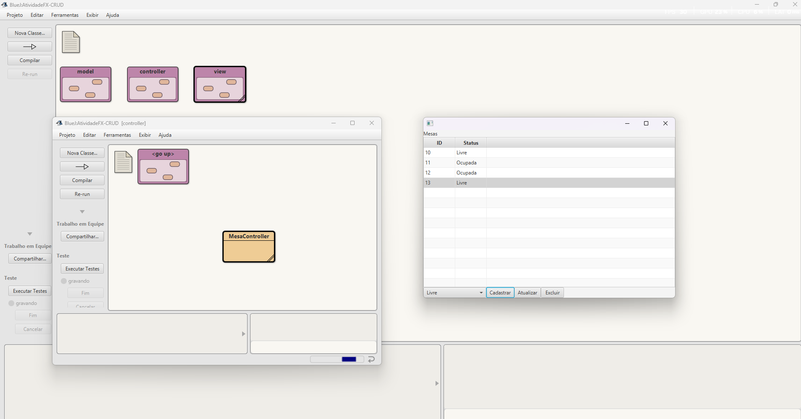
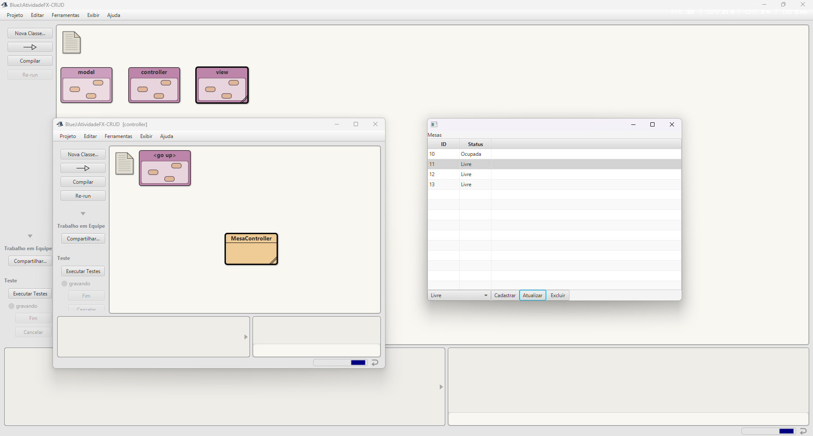

# Atividade JavaFX - CRUD

## Objetivo

Desenvolver uma aplicação desktop utilizando JavaFX, seguindo o padrão arquitetural MVC e integrando uma camada de persistência com SQLite e ORMLite.

A aplicação permite realizar operações CRUD sobre registros de mesas, possibilitando seu cadastro, consulta, atualização de status e exclusão.

## Tecnologias utilizadas

- Java
- JavaFX
- Scene Builder
- SQLite
- ORMLite
- BlueJ

## Organização do projeto

O projeto segue o padrão MVC:

- **Model:** contém a entidade `Mesa`, a classe `Database` e o repositório `MesaRepositorio`, responsável pelas operações de persistência.
- **View:** contém a interface gráfica definida em FXML, a classe `AppView` e a representação visual `Mesa`.
- **Controller:** contém a classe `MesaController`, responsável pela comunicação entre a interface e o modelo.

## Funcionalidades

- Cadastro de mesas com geração automática de identificador.
- Consulta dos registros por meio de uma `TableView`.
- Atualização do status de uma mesa.
- Exclusão de registros.
- Seleção de status entre "Livre" e "Ocupada".
- Persistência dos dados utilizando SQLite e ORMLite.

## Execução

O projeto foi desenvolvido e executado no BlueJ.

Para executar:

1. Abra o projeto `AtividadeFX-CRUD` no BlueJ.
2. Compile as classes.
3. Execute o método `main()` da classe `MesaController`.

O banco de dados SQLite é criado automaticamente quando a aplicação estabelece a conexão, caso o arquivo ainda não exista.

## Capturas de tela

As imagens da aplicação estão disponíveis no diretório `Imagens`.

### Tela inicial

### Cadastro de mesa

### Atualização de status

### Exclusão de mesa

## Aviso

Houve uso de IA para auxiliar na formatação da mensagem, assim como revisão do código.