Segue-se as informações a respeito da atividade sobre Persistência de Dados com ORM e CRUD:

A atividade foi realizada inspirando-se no código redigido e divulgado no GitHub do professor. Ou seja, o código base foi alterado
para se adequar ao tema do meu projeto.

A classe escolhida foi a classe Mesa, e o código ira permitir criar um banco de dados que guarde a quantidade de mesas desejadas, além
de permitir criar, deletar, encontrar e editar mesas.

Seguem as prints do código, separadas pro classe:

&#x09;- MesaRepository:
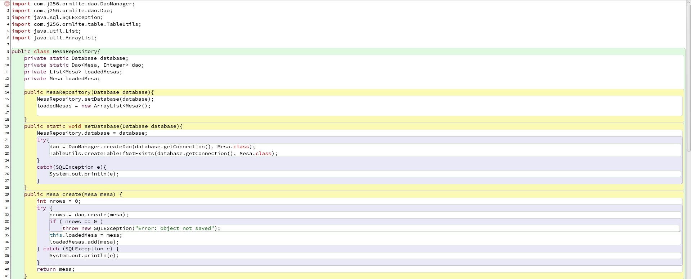

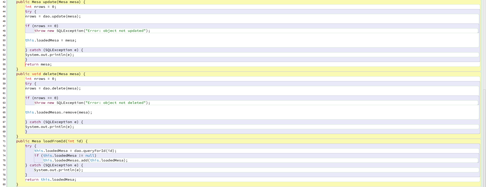

&#x09;- Database:
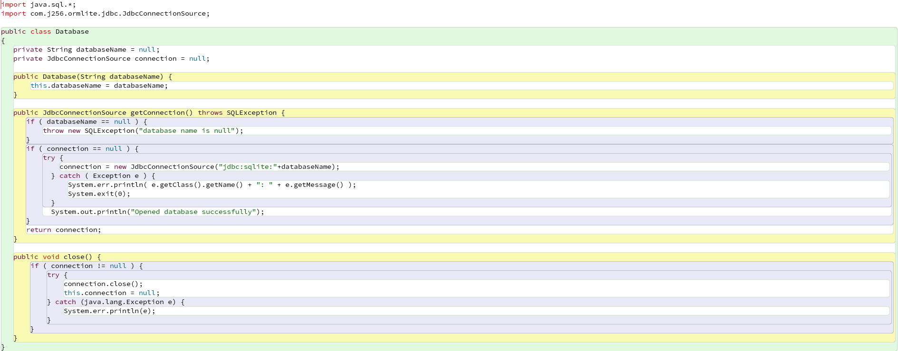

&#x09;- Mesa:

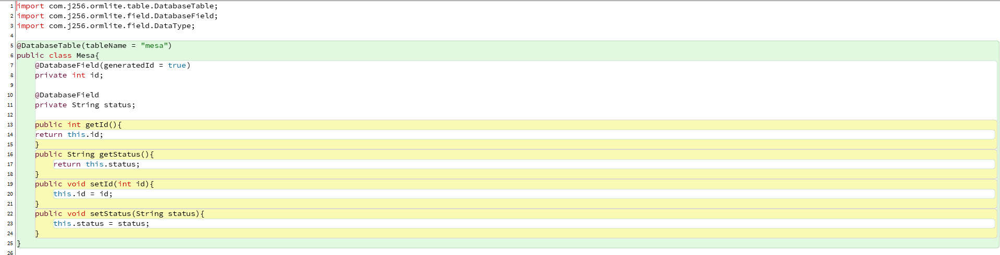

Agora, as próximas imagens vão demonstrar esse código posto em prática:

&#x09;- Criando objetos Database e MesasRepository, com um database criado corretamente:

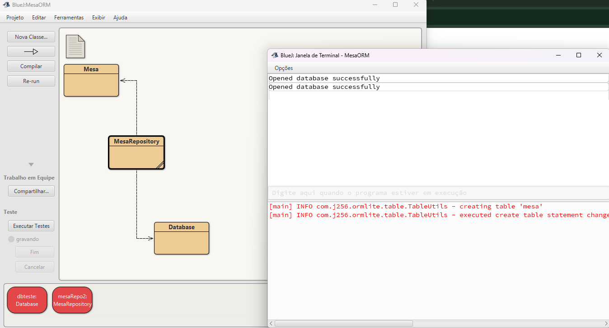

&#x09;- Criando objetos e os adicionando ao repositório:
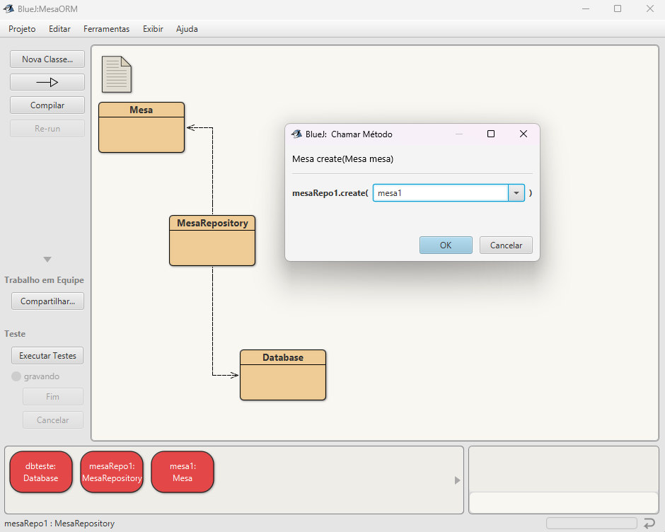

&#x09;

&#x09;- Checando quantos objetos estão guardados dentro do repositório:

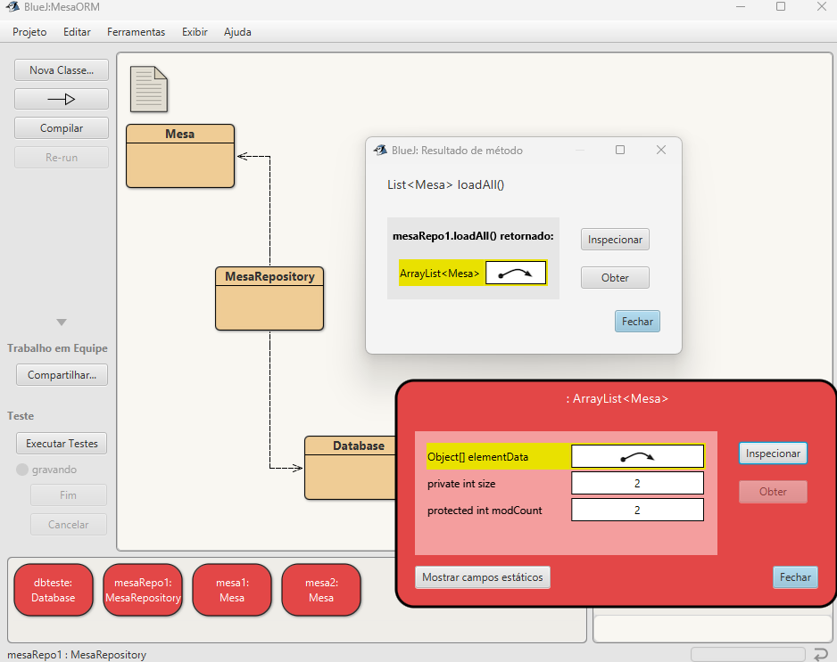

&#x09;- Encontrando objetos por Id:

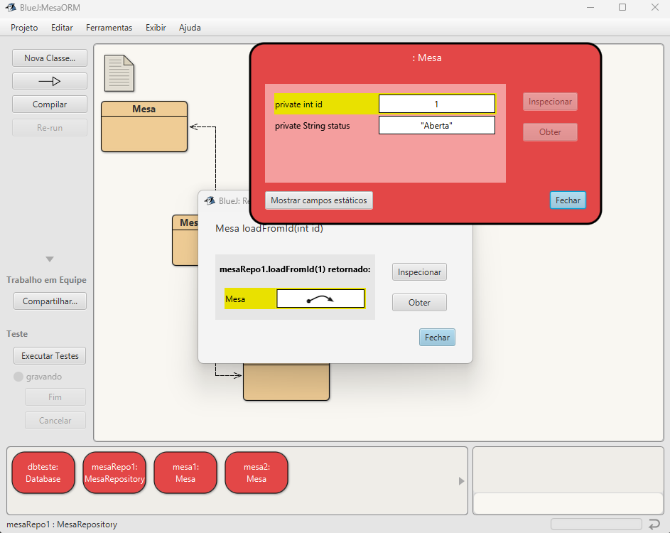

&#x09;

&#x09;- Alterando objetos e salvando-os no repositório:

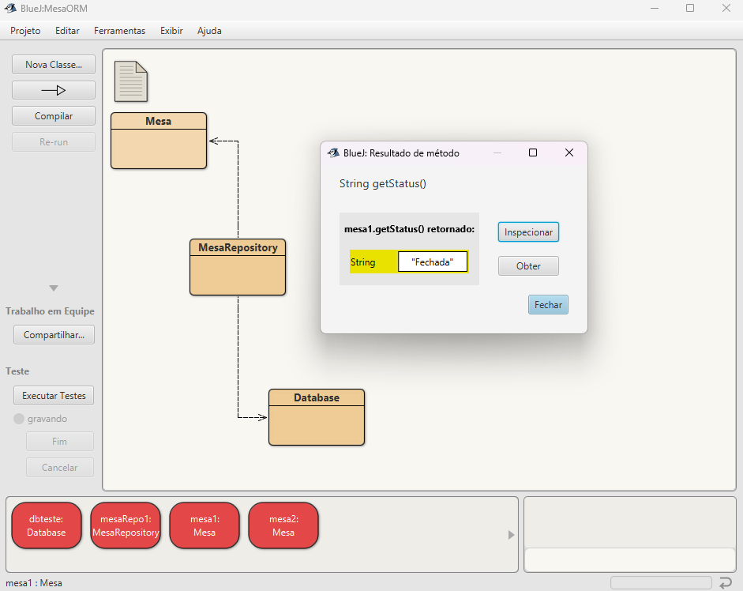

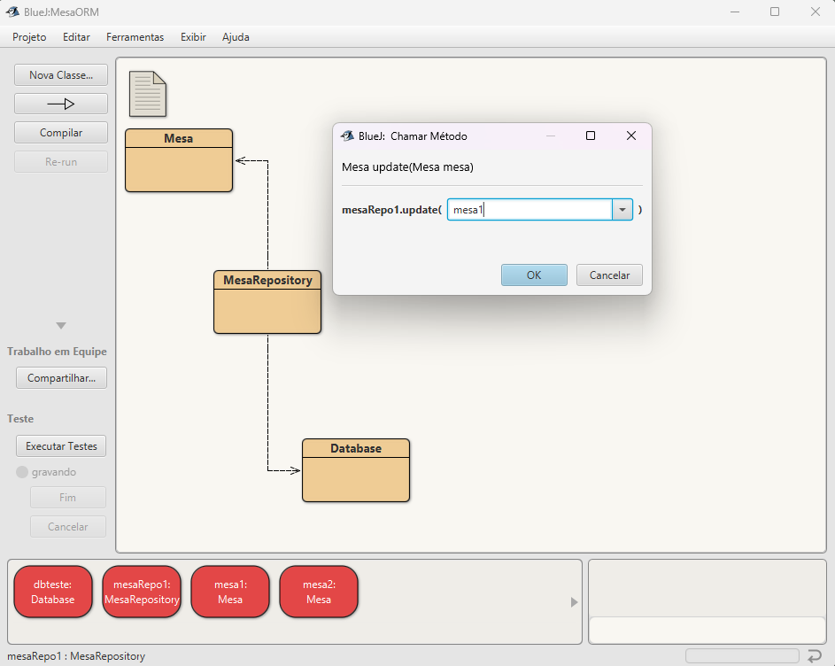

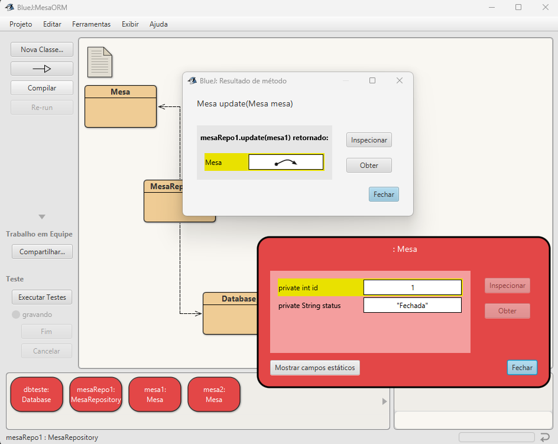

&#x09;

&#x09;- Deletando objetos dentro do repositório:

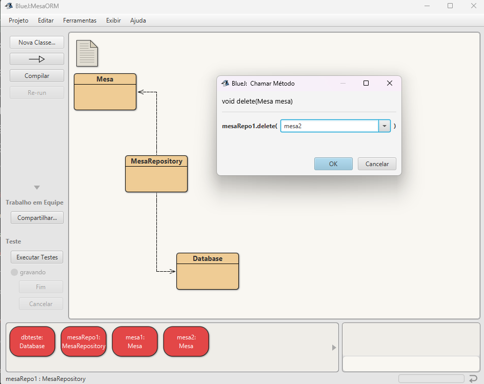

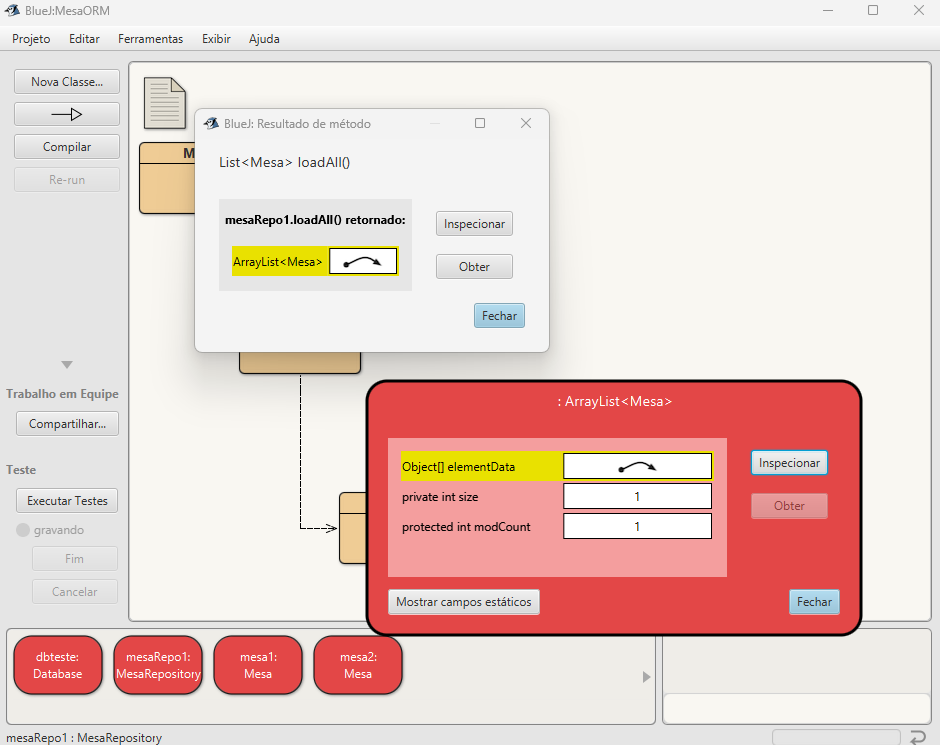

Com as imagens, percebe-se que o código funcionou como deveria. Por meio dele, foi possível adicionar objetos a um database,
modificá-los e depois atualizá-los dentro do repositório, verificar quantos estão presentes, encontrar um objeto por Id, e
deletá-los caso seja necessário.

